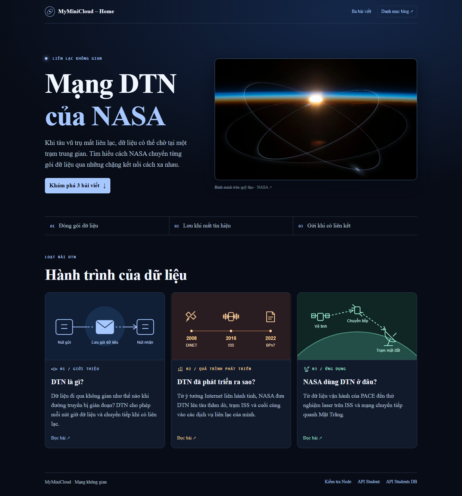
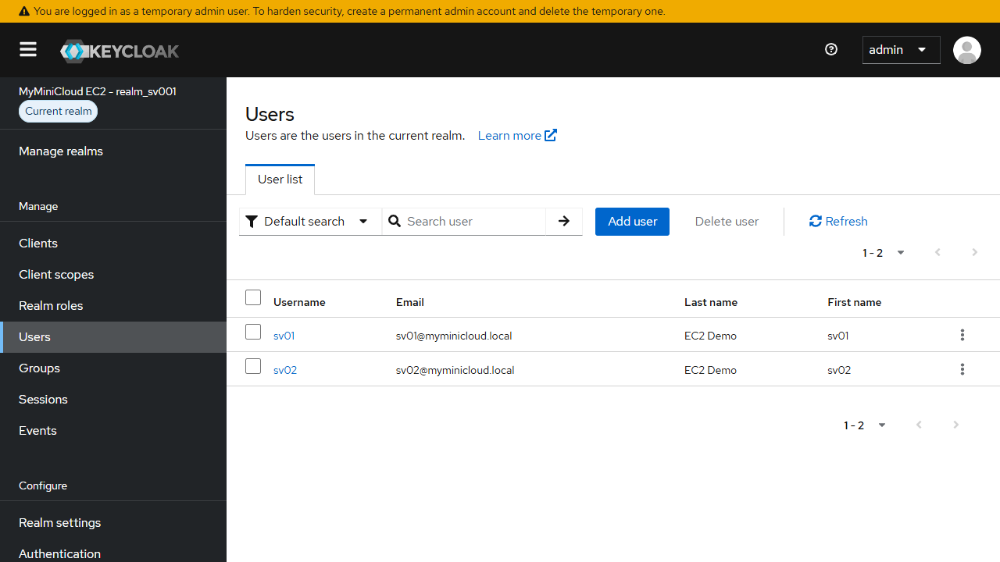
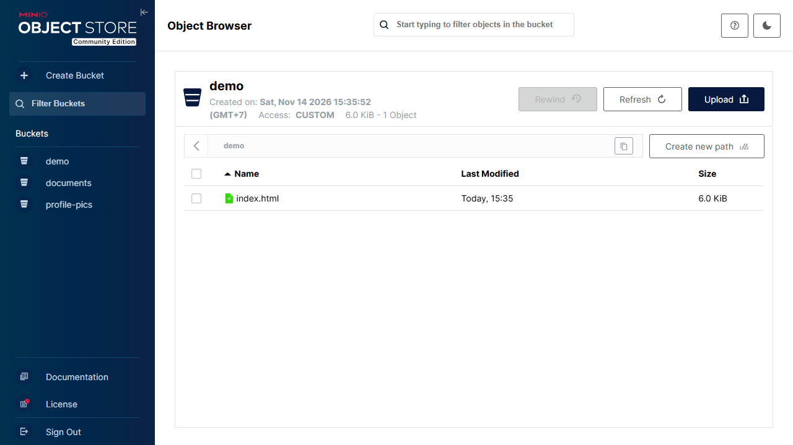
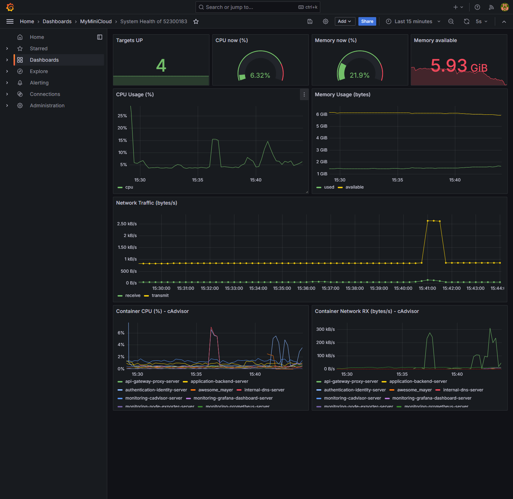
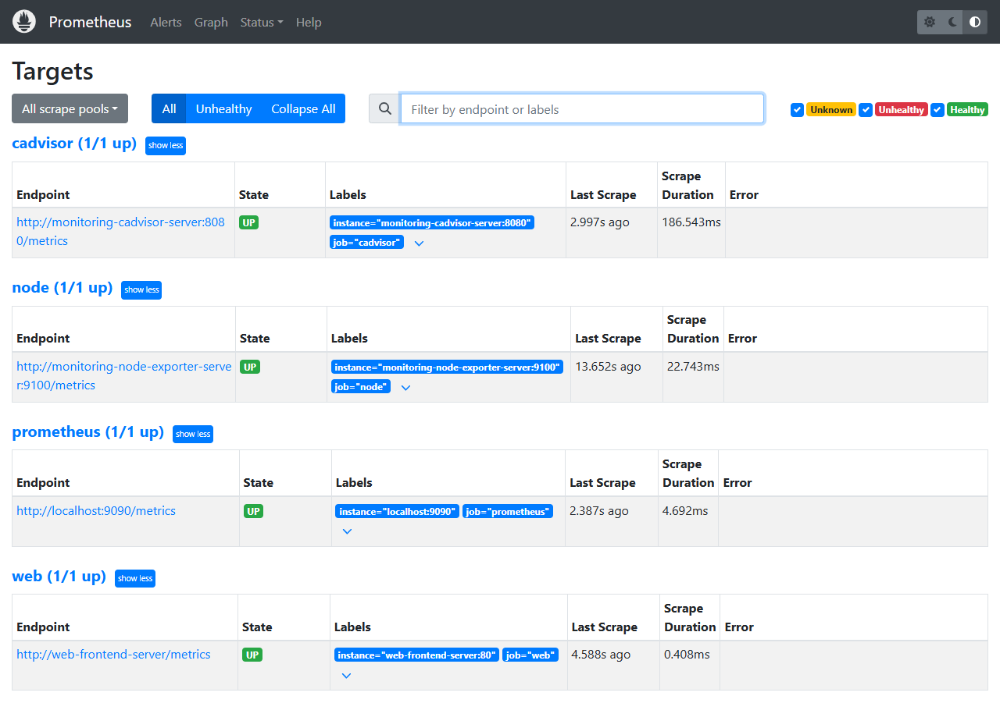

# Triển khai và nghiệm thu EC2 Ubuntu

Phần EC2 của TV1 Nguyễn Xuân Bằng, hoàn thiện ngày 14/11/2026 từ commit nhóm
`2e6f8e5353d906983ad3a26e7f1f918e15634406`.

Đã chạy đủ 12 container trên Ubuntu EC2, bổ sung Keycloak, MinIO và monitoring,
phục vụ Web/API qua HTTPS. Thư mục này chứa cấu hình bổ sung, script vận hành,
script kiểm thử và minh chứng của lần triển khai. Các tệp cấu hình bên dưới
được dùng cùng `docker-compose.yml` tại gốc kho mã.

## Máy và địa chỉ đã kiểm chứng

| Thông số | Giá trị |
|---|---|
| Loại máy | m7i-flex.large, 2 vCPU, 8 GiB RAM |
| Ổ gp3 | 30 GiB, 3000 IOPS, 125 MiB/s |
| Vùng | us-east-1c |
| Public IP | 54.227.182.163 |
| Mạng Docker | cloud-net, 10.10.10.0/24 |
| Web | https://54.227.182.163/ |

IP public có thể đổi sau khi stop/start instance. Cần cập nhật origin trong
`.env`, các hostname/redirect URI và cấu hình HTTPS khi IP đổi. Bảng địa chỉ
monitoring dưới đây là kết quả Docker cấp IP tại thời điểm nghiệm thu.

| Container | IP cloud-net | Host → container |
|---|---|---|
| api-gateway-proxy-server | 10.10.10.60 | 80 → 80; 443 → 443 public |
| web-frontend-server | 10.10.10.10 | 8080 → 80 |
| web-frontend-server-2 | 10.10.10.11 | 8082 → 80 |
| application-backend-server | 10.10.10.20 | 8085 → 5000; 5000 → 5000 |
| relational-database-server | 10.10.10.50 | 3306 → 3306 |
| authentication-identity-server | 10.10.10.40 | 8081 → 8080 |
| object-storage-server | 10.10.10.30 | 9000 → 9000; 9001 → 9001 |
| internal-dns-server | 10.10.10.53 | 1053 → 53 UDP và TCP |
| monitoring-node-exporter-server | 10.10.10.130 | 9100 → 9100 |
| monitoring-cadvisor-server | 10.10.10.129 | 8083 → 8080 |
| monitoring-prometheus-server | 10.10.10.131 | 9090 → 9090 |
| monitoring-grafana-dashboard-server | 10.10.10.132 | 3000 → 3000 |

Tám IP lõi giữ đúng bảng của README nhóm. Bốn IP monitoring là IP động trong
`10.10.10.128/25`. Cổng 443 được bổ sung riêng để phục vụ HTTPS trên EC2;
Compose gốc chỉ publish Gateway cổng 80. Các cổng host còn lại bind loopback
`127.0.0.1` trong cấu hình EC2.

## Cấu hình bổ sung trên EC2

- `Cau_hinh_EC2/full/compose.ec2.yml`: issuer/audience Flask, import realm
  `realm_sv001`, Node Exporter đọc host, cAdvisor chính thức 0.56.2 tương thích
  Docker 29, giới hạn lưu trữ Prometheus và bind monitoring về loopback.
- `Cau_hinh_EC2/full/compose.https.yml`: thêm Gateway 443, hostname HTTPS của
  Keycloak, đường dẫn Grafana, Prometheus và MinIO Console.
- `Cau_hinh_EC2/full/gateway-https.conf`: giữ Round Robin, Docker DNS và
  `backend_unavailable`; thêm TLS, ACME webroot và proxy WebSocket. Giao diện
  quản trị chỉ cho phép hai IP nguồn đã được duyệt trong cấu hình.
- `Cau_hinh_EC2/full/realm-sv001.sanitized.json`: mẫu realm, client public
  `flask-app`, audience mapper và hai user `sv01`, `sv02`; mật khẩu đã thay
  bằng `<SET_PRIVATE_VALUE>`.
- `Cau_hinh_EC2/full/renew-certificate.sh` cùng hai unit systemd: kiểm tra
  gia hạn chứng chỉ IP Let's Encrypt hai lần mỗi ngày, nạp lại Nginx sau đó.

Keycloak vẫn giữ realm `myminicloud` có sẵn của nhóm. Bản EC2 nhập thêm
`realm_sv001` theo đề và cấu hình Flask kiểm tra audience `flask-app`.
Keycloak chạy `start-dev` với dữ liệu volume theo phạm vi lab.

Các bản trong `Cau_hinh_EC2` dùng để đối chiếu và khôi phục có kiểm soát.
Mật khẩu thật, realm riêng đang dùng và khóa TLS được giữ trên EC2. Không
chạy mẫu realm có giá trị `<SET_PRIVATE_VALUE>` như dữ liệu đăng nhập thật.

## Vận hành máy đã triển khai từ PowerShell

Chạy tại gốc kho mã trên Windows. Truyền `-KeyPath` nếu khóa SSH ở vị trí khác.

```powershell
.\EC2\Van_hanh_EC2.ps1 -Action Status
.\EC2\Van_hanh_EC2.ps1 -Action Http
.\EC2\Van_hanh_EC2.ps1 -Action Start
```

`Start` gọi `.local/full/start.sh` trên EC2 và nạp đúng ba tệp Compose.
Instance phải đang Running trong AWS; script này không cấp mới, nâng loại máy
hoặc tự bật instance đã Stopped. `Renew` kiểm tra gia hạn TLS thủ công.
`Credentials` chỉ dành cho chủ máy xem thông tin đăng nhập qua SSH trên màn
hình riêng; không ghi đầu ra lệnh đó vào minh chứng hoặc video.

Trên EC2, cấu hình đang sử dụng được nạp từ gốc dự án:

```bash
cd /home/ubuntu/MyMiniCloud
docker compose -f docker-compose.yml \
  -f .local/full/compose.ec2.yml \
  -f .local/full/compose.https.yml up -d --no-build --wait --wait-timeout 420
```

Các tệp `full/` công khai là bản đối chiếu; `.local/full/` trên EC2 còn chứa
realm có mật khẩu riêng và ACME webroot đã được chuẩn bị khi triển khai.
Chứng chỉ trong `/etc/letsencrypt` không được đưa vào Git.

## Truy cập dịch vụ

| Chức năng | Đường dẫn trên https://54.227.182.163 |
|---|---|
| Web và blog | `/`, `/blog/blog1.html` đến `/blog/blog3.html` |
| Kiểm tra cân bằng tải | `/node` |
| Flask | `/api/hello`, `/api/student`, `/api/students-db`, `/api/secure` |
| Keycloak quản trị | `/auth/admin/master/console/` |
| MinIO Console | `/minio/ui/` |
| Prometheus Targets | `/prometheus/targets` |
| Grafana | `/grafana/d/system-health/system-health-of-52300183` |
| Avatar công khai | `/profile-pics/avatar.jpg` |

Các giao diện quản trị cần IP nguồn được duyệt; Keycloak, MinIO và Grafana
còn yêu cầu đăng nhập. `documents/report-tv3.pdf` không được cấp quyền đọc
ẩn danh. Policy chỉ cho phép đọc công khai hai object demo đã kiểm thử.

## Kết quả nghiệm thu

| Phép thử | Kết quả |
|---|---|
| Bộ kiểm thử tổng hợp | 10 nhóm PASS, 0 FAIL |
| Container | 12 Running; 9 healthcheck healthy; không OOM |
| Web | Home và 3 bài 200, 7 ảnh khớp SHA256, có liên kết về Home |
| Round Robin | 10 lượt luân phiên đúng node, header và upstream |
| Gateway khi container Backend không tồn tại | 16/16 lượt HTTP và HTTPS đúng 200/503; Backend được khôi phục |
| API và database | 12 lượt routing đạt; 5 sinh viên; notes có 2 dòng |
| Keycloak | Hai user lấy token; 6 lượt secure đạt; thiếu/sai token trả 401 |
| MinIO | 3 bucket; upload/download 3 file khớp checksum; PDF ẩn danh trả 403 |
| DNS | 68 truy vấn UDP/TCP đúng ở hai zone |
| Ping nội bộ | 12 OK, 0 FAIL, 0 SKIP |
| Prometheus | node, web, cadvisor, prometheus đều UP; nhận đủ 12 tên container |
| Grafana | Datasource OK; dashboard 9 panel có dữ liệu; WebSocket mở thành công |
| TLS | Chứng chỉ IP hợp lệ tại lúc kiểm thử; diễn tập gia hạn thành công |

Các số liệu trên là minh chứng ngày 14/11/2026, không phải trạng thái cập nhật
liên tục. Xem `Minh_chung/Ubuntu/result.json`, `backend-absent-test.json`,
`ping-test.txt`, `certificate-renewal-dry-run.txt` và các tệp JSON cùng thư mục.
`Lenh_da_thuc_hien/verify-full.py` dùng dữ liệu riêng đã có trên EC2, thực hiện
cả phép thử tạo bucket/upload file mẫu; chạy trong môi trường lab được phép.

## Ảnh giao diện

Ảnh chụp trực tiếp qua HTTPS EC2 nằm tại `Minh_chung/Anh_giao_dien/`.











## Đối chiếu tệp

`SHA256SUMS.txt` liệt kê checksum các tệp công khai trong thư mục này.
Dockerfile, nội dung Web, cấu hình DNS, cấu hình datasource/dashboard và
Compose gốc đã có tại gốc kho mã nên không sao chép thêm vào hồ sơ EC2.
Hai tài liệu đối chiếu được yêu cầu loại trừ không nằm trong bộ này.

Các bản log công khai đã chuẩn hóa LF và bỏ khoảng trắng cuối dòng; kết quả, thời điểm và số liệu được giữ nguyên.
